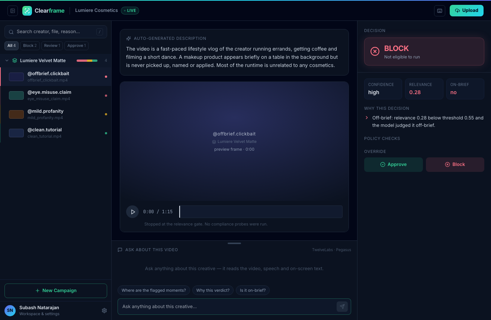

<h1 align="center">ClearFrame</h1>

<p align="center"><strong>Brand-safe clearance for creator video ads.</strong></p>

<p align="center">
  An automated ad-compliance gate for creator videos. For every creative it returns an
  <strong>APPROVE&nbsp;/&nbsp;REVIEW&nbsp;/&nbsp;BLOCK</strong> decision, an auto-generated description, and
  <strong>timestamped evidence</strong> for every reason behind the call.
</p>

<p align="center">
  
  
  
  
  
</p>

<p align="center"></p>

> **The model perceives. The engine decides.**
> TwelveLabs understands what happens in a video across visuals, speech and on-screen text.
> A separate, **deterministic** policy engine turns that into the verdict — because in an ads
> system, a wrong auto-block on a large advertiser is a revenue and trust incident, not just a bug.

---

## ✨ Highlights

- **Three-pane reviewer console** — searchable, foldered queue · evidence timeline · decision panel, all on one screen.
- **Real video understanding** — TwelveLabs Marengo (search) + Pegasus (reasoning) over visuals, speech and on-screen text.
- **Deterministic verdicts** — a config-driven policy engine (no LLM makes the final call) → auditable, tunable, consistent.
- **Timestamped evidence** — every flagged moment is a clip you can click and watch.
- **Chat with the video** — ask anything about a creative; answers come from the indexed video.
- **Live progress** — watch each creative move through the pipeline stage by stage.
- **Human-in-the-loop** — low-confidence calls route to a reviewer; overrides are recorded alongside the automated verdict.
- **Runs with zero setup** — mock mode uses recorded fixtures, so the whole app works before you add a key.

## 🚀 Quickstart

```bash
make install          # backend (pip) + frontend (npm) deps
make seed             # reset to one demo campaign with four sample creatives
make api              # FastAPI backend on http://localhost:8000
make web              # Vite frontend on http://localhost:5001
```

Open the frontend — it detects the backend and runs **live**. Everything works in **mock mode**
out of the box (no key, no quota). To run on real videos:

1. Open **Settings** (bottom-left) → paste your **TwelveLabs API key** → Save.
   It's validated against TwelveLabs, then **encrypted at rest** server-side (the browser only ever sees a masked preview).
2. **Upload** a single video (→ Unsorted) or create a **campaign** and drop a batch.
3. Watch the live stages → real verdict, evidence timeline, and chat.

> No backend running? The frontend falls back to a self-contained demo so it always renders.

## 🧠 How a decision is made

```
 ┌──────────┐   ┌──────────────┐   ┌────────────┐   ┌──────────────────┐   ┌──────────────┐
 │ Indexing │ → │ Relevance    │ → │ Analyzing  │ → │ Gathering        │ → │ Deciding     │
 │ (Marengo)│   │ gate (Marengo)│   │ (Pegasus)  │   │ evidence (Marengo)│   │ (rules)      │
 └──────────┘   └──────────────┘   └────────────┘   └──────────────────┘   └──────────────┘
```

1. **Relevance gate** — a Marengo search of the campaign brief against the creative. Off-brief clickbait is rejected before deep analysis.
2. **Reasoning pass** — Pegasus returns a 2–5 sentence description, an on-brief judgement, and structured policy findings.
3. **Evidence pass** — per-policy Marengo probes return timestamped, confidence-scored clips that corroborate known-bad patterns.
4. **Decision engine** — deterministic, config-driven: combines the signals into APPROVE / REVIEW / BLOCK. The most serious calls require reasoning **and** evidence to agree.

Confidence: two-source agreement is high, a single source is medium. Any automated APPROVE/BLOCK below the
configured minimum confidence is downgraded to REVIEW so a human looks at it.

## 🏗 Architecture

| Layer | Tech | Role |
|---|---|---|
| **Frontend** | React 18 + Vite | Three-pane reviewer console; live or demo mode |
| **API** | FastAPI | Campaigns, uploads, live stage progress, chat, decisions |
| **Perception** | TwelveLabs v1.3 (Marengo 3.0, Pegasus 1.2) | Indexing, search, reasoning |
| **Decision** | Pure-Python rules engine | Deterministic APPROVE/REVIEW/BLOCK |
| **Data** | SQLite (default) → Supabase Postgres | Campaigns, reviews, settings |
| **Storage** | Local disk (default) → Supabase Storage | Uploaded videos |
| **Secrets** | Fernet-encrypted | TwelveLabs key never leaves the server in plaintext |

The data and storage layers are **config-swappable**: set `DATABASE_URL` to use Supabase Postgres,
or `SUPABASE_*` to store videos in Supabase Storage. No code changes — see [Configuration](#-configuration).

## 📁 Project structure

```
clearframe/
├── backend/
│   ├── api.py                 # FastAPI app: campaigns, uploads, progress, chat, decisions, settings
│   ├── seed_demo.py           # `make seed` — one demo campaign with four samples
│   ├── src/
│   │   ├── client.py          # TwelveLabs v1.3 REST client (+ fixture-backed mock)
│   │   ├── pipeline.py        # orchestrates the stages, streams progress
│   │   ├── decision.py        # the deterministic policy engine (the heart)
│   │   ├── relevance.py       # stage 1: on-brief relevance gate
│   │   ├── analyze.py         # stage 2: Pegasus structured reasoning
│   │   ├── search.py          # stage 3: Marengo timestamped evidence
│   │   ├── schemas.py         # pydantic contracts
│   │   ├── db.py              # SQLite / Supabase Postgres data layer
│   │   ├── keystore.py        # Fernet-encrypted API key storage
│   │   ├── indexes.py         # TwelveLabs index lifecycle
│   │   └── storage.py         # Supabase Storage upload + signed URLs
│   ├── config/                # GARM-mapped policy taxonomy + campaign brief (YAML)
│   ├── fixtures/              # recorded TwelveLabs responses for the demo scenarios
│   └── tests/                # decision-engine unit tests
├── frontend/
│   └── src/ClearframeApp.jsx  # the three-pane reviewer console
└── docs/                      # design doc + screenshot
```

## ⚙️ Configuration

Copy `backend/.env.example` to `backend/.env`. All values are optional — unset means mock/local.

| Variable | Purpose |
|---|---|
| `TL_API_KEY` | TwelveLabs key (or set it in the UI → Settings, stored encrypted) |
| `DATABASE_URL` | Postgres/Supabase connection string. Unset → local SQLite |
| `SUPABASE_URL`, `SUPABASE_SERVICE_KEY`, `SUPABASE_BUCKET` | store uploaded videos in Supabase Storage. Unset → local disk |

Check what's active any time: `curl localhost:8000/api/health` → `{ mock, db, storage }`.

## 🛡 Policy taxonomy

Policies live in `backend/config/policies.yaml`, mapped to the GARM Brand Safety Floor and Suitability
Framework: hate/harassment, drugs/illegal, profanity, unsafe product usage, and medical/cosmetic claims,
plus a campaign relevance gate. Adding a category or changing a tolerance is a **config edit, not a code change**.

## 🧪 Testing & evaluation

```bash
make test     # decision-engine unit tests (5/5)
make eval     # score the engine against the labeled set: precision/recall + confusion matrix
make demo     # run the pipeline over the four samples in mock mode, write an HTML report
```

`make eval` runs a labeled set of 16 compliance scenarios through the real
decision engine and reports a verdict confusion matrix, per-policy
precision/recall, and the cost-weighted errors that actually matter — *false
blocks* (hurt the advertiser) and *missed flags* (hurt brand safety). Current
result: **16/16, 100% verdict accuracy, 0 false blocks, 0 missed flags**
([full report](backend/eval/REPORT.md) · [how it works](backend/eval/README.md)).
The set deliberately probes the subtle rules, so relaxing any threshold trips a
FAIL with a non-zero exit code — it doubles as a regression gate. It measures the
deterministic engine, holding model perception fixed; perception accuracy is a
separate layer that needs labeled real videos.

## 🗺 Status

What runs today: the full pipeline, a live FastAPI API (campaigns, progress, chat, decisions), an
encrypted key store, a Supabase-ready data/storage layer, and the reviewer UI — end to end, mock or live.
What a deployed multi-tenant product still needs: hosting, Supabase in place of SQLite/local disk, auth
and per-advertiser tenancy, a real queue and object storage, and monitoring. See
[`docs/Clearframe_Design_Doc.pdf`](docs/Clearframe_Design_Doc.pdf) for the full design and scale story.

## 🤝 Contributing

See [CONTRIBUTING.md](CONTRIBUTING.md). In short: open an issue, branch, keep changes small and tested, and run `make test` before a PR.

## 📄 License

[MIT](LICENSE)
